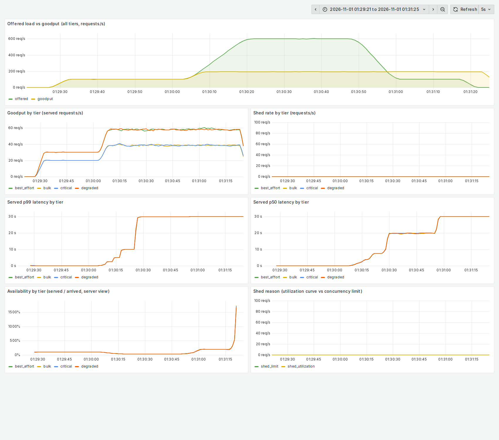
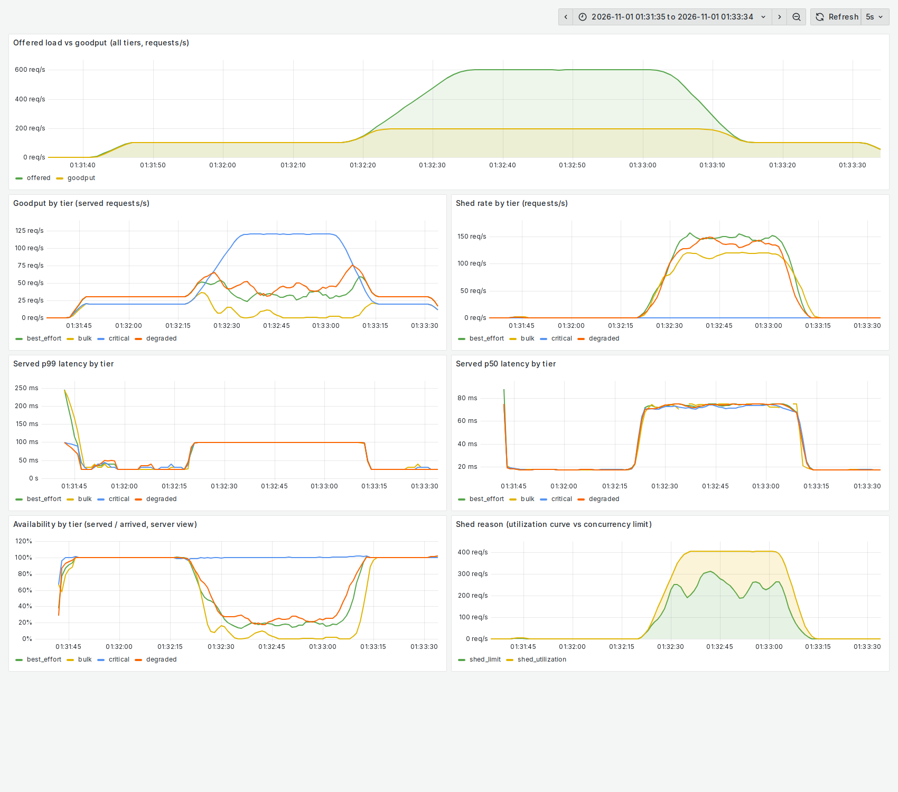

# Results in detail

The headline numbers are in the [README](../README.md#at-a-glance). Everything here was measured on
one 4-core machine against the demo backend, with the load generator on the same machine. The
numbers show how the pieces behave relative to each other; they are not claims about production
capacity.

Everything below was measured on one 4-core machine against the demo backend, with the load
generator on the same machine. The numbers show how the pieces behave relative to each other;
they are not claims about production capacity. Read "Limitations" for how noisy that machine was.

### 6x spike (Gatling, `scripts/spike.sh`)

100 rps baseline, ramp to 600 rps, hold 30 s, recover. The sleep-based backend serves about
200 rps, so the peak is about 3x its capacity. Success is the client view (a 503 or a timeout is a
failure). Latency is for served requests, estimated from the server's histogram. Three rounds per
mode, interleaved to cancel drift. These runs predate the lock free signals and the critical
`Retry-After` change listed under "Decisions". Two later batches of the shed mode gave critical
99.2% to 100%, but three runs taken while the machine was heavily loaded gave 80.7%, 99.1% and
90.4% (see "Limitations").

| Mode | Critical success | Critical p50 / p99 | Degraded / best-effort / bulk success |
|---|---|---|---|
| No protection | 20.4% | timeouts (5 s) | 20.5 / 20.4 / 20.4% |
| Limiter only (windowed Gradient2) | 100% (3/3) | 68 / 99 ms | 36.5 / 35.6 / 39.5%, no ordering |
| Shed curves + limiter, default thresholds | 99.4% (98.4-100) | 23 / 151-239 ms | 46.2 / 21.6 / 18.5%, ordered |
| Shed curves + limiter, tuned thresholds | 100% (3/3) | 21 / 194-216 ms | 43.3 / 20.7 / 17.7%, ordered |

What this shows:

- Without protection, every tier fails equally and latency runs into the client timeout.
- The windowed adaptive limiter alone already keeps critical traffic available on this backend.
- The shed curves add a real priority order among the lower tiers: degraded is served more than
  best-effort, more than bulk. The limiter alone treats those three the same.
- In these unpinned runs the curves also gave lower critical median latency (23 ms against 68 ms),
  but that gap did not survive a fairer comparison; see "Controls" below.
- The tuned thresholds are not distinguishable from the hand-picked defaults on goodput.

### Dashboards

Prometheus and Grafana (`monitoring/`, `docker compose up -d`) with a provisioned dashboard.
The same spike, without protection and with Sieve:

Without protection, goodput is stuck at the backend's capacity while latency climbs to tens of
seconds. The server keeps finishing a backlog of requests whose clients gave up after 5 s, which
is why "availability" in the server's own view rises above 100% at the end; the client view in the
table above is the real one.

With Sieve, offered load reaches 600 req/s while goodput holds near capacity. All critical
traffic (120 req/s) is served and the lower tiers absorb the shedding. The flat 100 ms p99 is the
histogram's bucket boundary, not a measurement of exactly 100 ms.

### Retry storms (`scripts/retry-storm.sh`)

A sudden 600 rps for 10 s against the shedding server, with clients retrying three ways. "Load"
is calls sent to the server per original request. Three runs each.

| Client retries | Critical success | Critical p99 | Degraded success | Load, degraded tier |
|---|---|---|---|---|
| None | 97.6% | 251 ms | 35.0% | 1.00x |
| Naive: 2 immediate retries | 90.0% (87.5-93.6) | 2.7 s | 11.5% | 2.87x |
| `RetryPolicy` (budget) | 99.4% (99.2-99.7) | 302 ms | 33.6% | 1.00x |

Naive retries make the overload worse: they nearly triple the load from the lower tiers and cost
critical traffic availability. The retry budget adds 6% to the critical tier's calls and nothing measurable elsewhere, because
the lower tiers' `Retry-After` hints (2-10 s) exceed the 1 s it is willing to wait.

Shed critical requests are told `Retry-After: 0` and the client's full-jitter backoff spreads
them out. An earlier version told them to wait 1 s, which put the critical p99 at about 1.2 s; the
change cut it to 0.3 s.

Against a server with no shedding, nothing helps (about 22% success whichever way clients retry),
but naive retries still send 2.5x the calls.

### CPU-bound backend

The demo can burn CPU instead of sleeping (`SIEVE_BACKEND=cpu`). 4 spinning workers serve about
200 rps; load goes from 50 to 300 rps. CPU is the only shedding signal, with a 50% autoscaling
target (non-critical shedding from 60% CPU, critical from 80%). Two rounds per mode.

| Mode | Critical success | Critical p99 | Degraded / best-effort / bulk success |
|---|---|---|---|
| No protection | 41% | timeouts (5 s) | 41 / 41 / 41% |
| System-wide CPU (earlier batch) | 95.5-96.2% | 98-139 ms | 60 / 40 / 24% |
| System-wide CPU (later batch) | 78.6-89.2% | 68-79 ms | 44 / 26 / 16% |
| Process CPU (`CpuSignal.process()`) | 100% | 105 ms | 72.5 / 64.7 / 57.0% |

System-wide CPU includes the load generator and anything else on the machine, so the same
configuration gave 96% critical in one batch and 84% in another. Reading only this process's CPU
removed that: critical was fully protected and the lower tiers kept much more of their traffic,
because they were no longer shed for CPU the server did not use. On a shared machine, use
`CpuSignal.process()`; where the signal must line up with an autoscaler that scales on instance
CPU, use `system()` (Spring: `sieve.cpu-scope`).

### Auto-tuner (`sieve-demo`, `Tuner`)

Coordinate descent over the shedding thresholds, each trial a real server process under a real
spike, averaged over two runs. The score requires critical success of at least 99% and p99 under
400 ms, then rewards the weighted goodput of the other tiers. Two search runs agreed on the
shape of the landscape:

- A 40 ms latency target sheds too much (best-effort success falls to 2%).
- A 90 ms target or looser admits more lower-tier traffic (17-20% each) but critical drops to
  about 98% and the trial is rejected.
- Around 60 ms the score is a plateau, so the tuned configuration (+8% score) did not validate as
  better than the defaults in the full spike above.

### Controls

Checks run to see which results hold up, each against the same spike.

- **Core pinning.** Server on cores 0-1 and Gatling on 2-3 (`SIEVE_PIN=1`). With both modes
  pinned, critical p50 is 51-55 ms with shedding against 57-58 ms limiter-only, so the 3x latency
  gap seen unpinned was the server having spare CPU, not the curves. Both keep critical at 100%.
  What stays: the tier ordering (degraded 57% against 37% limiter-only, bulk 21% against 40%).
  Pinning also tightened the tail: shed p99 was 84-97 ms against 151-239 ms unpinned.
- **Limiter limits.** The library's own windowed Gradient2 limits (initial 20, minimum 20) against
  the tight 10 / 4 used for this 4-worker backend: critical availability is the same (99.2% against
  99.9%), limiter-only critical p50 is 100 ms against 60 ms, and degraded goodput under shedding is
  36% against 48%. The defaults are acceptable; sizing the floor to the service buys latency and
  lower-tier goodput, not critical availability.
- **Hot path.** `Sieve.admit()` with two latency signals, 4 threads: about 1.9M admits/s before
  the signals became lock-free and cached, about 3.9M after (one thread: about 1.0M to 2.1M). That
  is about 0.5 microseconds per request, and it was never the bottleneck at the 600 rps used here.

### What these results establish

They establish how the pieces compare on one 4-core machine, at one baseline of 100 rps, against a
simulated backend that serves about 200 rps: priority shedding keeps critical requests available
under a 3x overload, orders the lower tiers, and a retry budget stops clients from amplifying it.

They do not establish production capacity, behaviour over a real network, behaviour with a real
downstream dependency, or a latency advantage for the curves over the limiter alone. Trial order
was fixed within each round (not shuffled), so slow drift on the machine could favour a later arm.
The tuned and default thresholds were not statistically separated.

Raw per tier results, server metrics and a manifest of the environment (commit, JDK, kernel, CPU)
are in `docs/evidence/`; `scripts/archive-evidence.sh` creates a new bundle. Each Gatling run also
prints a check that critical was never served less than another tier.

### Decisions and rejected ideas

| Idea | What I measured | Decision |
|---|---|---|
| One latency threshold for every tier | Critical was shed at 87-90% success in the 400 rps phase | Replaced by a target threshold (lower tiers only) and a max threshold (everything) |
| Bare Gradient2 limiter | Limiter-only critical success 79.6% | Wrapped in `WindowedLimit`: 99.9% |
| Library limits (20 / 20) against tight limits (10 / 4) | Same critical availability; limiter-only critical p50 100 ms against 60 ms | Library keeps its defaults; the demo uses 10 / 4 |
| 2 s signal window instead of 5 s | Cold start 71% against 16% critical, but 62% against 80% at 800 rps, one run each | Not adopted, inconclusive |
| Probe fraction to break the low traffic latch | Not run: the latch is already bounded by the window, and a 1% probe cannot dilute stale samples faster | Rejected on reasoning |
| Tuned thresholds | Score +8% in the tuner, not separable from defaults in the full spike | Defaults kept |
| Critical `Retry-After` of 1 s | Retried critical p99 1.2 s | Changed to 0 with client jitter: 0.3 s |
| System wide CPU signal | Critical 79-96% depending on what else ran on the machine | `CpuSignal.process()` added: 100%; Spring default stays `system` to match autoscalers |
| Lock held on every signal read | 1.9M admits/s on 4 threads | Lock free and cached: 3.9M |
| io_uring | Not measured; syscall cost is negligible at these rates | Not pursued |

### Limitations

- The backend is simulated and the machine is shared with the load generator.
- The machine was shared with other work (a browser, other editor sessions and background
  indexing). With none of my processes running, the whole machine measured 18% to 37% busy over
  six 5 second samples, about one core of four. I did not record host state for most runs. Late in the session the shed mode gave inconsistent critical success at the standard
  6x spike (99.1%, 90.4%) and in an overload search from 6x to 12x (63.6% to 80.7%), against 99.2%
  to 100% in two earlier batches. I could not establish the cause and do not report those as
  results. I first blamed load averages of 6 to 8, but those were mostly this benchmark's own
  load, so they are not evidence of interference. The harness's busy check was reworked for that
  reason: the harness now samples CPU busy time instead (see
  [configuration.md](configuration.md)), and with a 15% limit it flags every run on this machine as
  noisy.
- Latency figures depend on how much CPU the server has to itself (see "Controls" above): unpinned runs
  and runs with the Prometheus and Grafana containers up differ by 2-3x in critical p50. Compare
  modes only within the same setup.
- Per-tier p99 comes from histogram buckets (1.25x steps in the latest version, coarser in the
  runs in the first tables).
- The limiter's tight floor and starting limit (4 and 10) are tuned to this 4-worker backend and
  are not general defaults. The library's own defaults (20 and 20) are looser.
